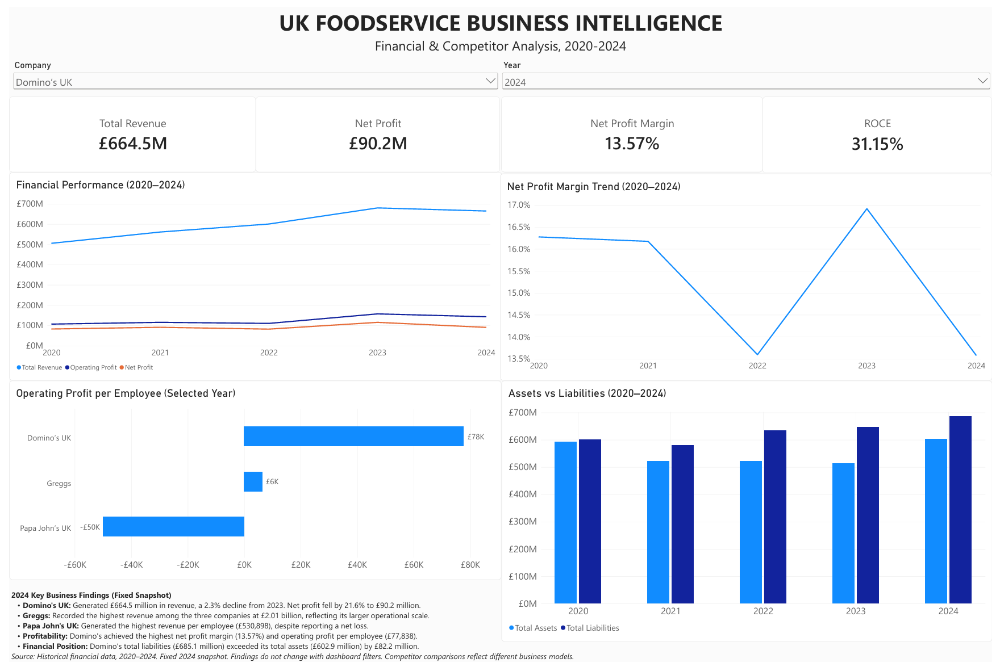

# UK Foodservice Business Intelligence

### Financial Performance & Competitor Analysis (2020–2024)

## Project Overview

This project investigates the financial performance, profitability, operational efficiency and competitive positioning of three UK foodservice businesses: **Domino's Pizza UK, Greggs and Papa John's UK**.

Using **Microsoft Power BI and Excel**, the project combines historical financial data with an interactive business intelligence dashboard to compare company performance between 2020 and 2024.

The analysis covers revenue, operating profit, net profit, financial ratios, employee productivity and balance sheet indicators.

An accompanying business intelligence report provides a detailed case study of **Domino's Pizza UK**, examining its financial performance, competitive environment, market position and strategic risks.

This project demonstrates skills in:

- Business intelligence and dashboard development
- Financial data analysis and KPI reporting
- Data preparation and transformation
- DAX measures and financial calculations
- Competitor benchmarking
- Data visualisation and business interpretation

## Power BI Dashboard



The interactive Power BI dashboard provides a consolidated view of financial performance and competitor comparisons across the three businesses.

### Dashboard Features

| Feature | Description |
|---------|-------------|
| Company Filter | Switch between Domino's UK, Greggs and Papa John's UK |
| Year Filter | Select a reporting year between 2020 and 2024 |
| KPI Cards | Display revenue, net profit, net profit margin and ROCE |
| Financial Performance | Visualise revenue, operating profit and net profit trends |
| Profit Margin Analysis | Compare profitability over five years |
| Competitor Benchmarking | Compare operating profit per employee across all three businesses |
| Assets vs Liabilities | Examine balance sheet trends and financial risk |
| Key Business Findings | Summarise the main findings from 2024 |

The KPI cards respond to company and year selections, while the historical charts display trends across the full five-year period.

The competitor comparison chart supports year-specific benchmarking, and the key findings section provides a fixed 2024 summary.

## Project Structure

```text
uk-foodservice-business-intelligence/
│
├── 01_data/
│   └── uk_foodservice_data.xlsx
│
├── 02_dashboard/
│   └── uk_foodservice_business_intelligence.pbix
│
├── 03_visualisations/
│   └── dashboard_overview.png
│
├── 04_reports/
│   └── uk_foodservice_BI_report.pdf
│
└── README.md
```

### File Descriptions

| File | Description |
|------|-------------|
| `uk_foodservice_data.xlsx` | Power BI-ready Excel workbook containing financial data, market information, data definitions and quality checks |
| `uk_foodservice_business_intelligence.pbix` | Interactive Power BI dashboard featuring financial performance and competitor analysis |
| `dashboard_overview.png` | Screenshot of the completed Power BI dashboard |
| `uk_foodservice_BI_report.pdf` | Supporting business intelligence report focusing on Domino's Pizza UK |
| `README.md` | Project documentation, methodology and findings |

## Dataset

### Data Overview

The project uses historical financial data from **2020 to 2024**, covering three UK foodservice businesses.

The financial dataset contains **15 company-year observations**, representing five years of financial information for each business.

### Companies Analysed

| Company | Business Focus |
|---------|----------------|
| Domino's Pizza UK | Pizza delivery and takeaway |
| Greggs | Bakery and food-on-the-go retail |
| Papa John's UK | Pizza delivery and takeaway |

### Financial Metrics

The analysis includes:

- **Revenue:** Total annual revenue.
- **Operating Profit:** Profit generated from operating activities.
- **Net Profit:** Profit after relevant expenses and taxation.
- **Net Profit Margin:** Net profit as a percentage of revenue.
- **Return on Capital Employed (ROCE):** Operating profit relative to capital employed.
- **Total Assets:** Reported company assets.
- **Total Liabilities:** Reported company liabilities.
- **Employee Count:** Number of employees reported annually.
- **Revenue per Employee:** Revenue divided by employee count.
- **Operating Profit per Employee:** Operating profit divided by employee count.

Financial amounts were standardised into pounds sterling (£), allowing consistent calculations across the dataset.

### Data Sources

The project draws on historical financial and industry information from:

- **FAME (Financial Analysis Made Easy):** Company financial data.
- **Mintel:** UK foodservice market research and consumer purchasing behaviour.
- **Statista:** Supporting competitor and market information.
- **Company financial publications:** Additional financial and operational context.
- **Industry and news reports:** Supporting strategic analysis.

The Excel workbook includes source documentation, variable definitions and data quality checks.

## Methodology

### 1. Data Preparation

Microsoft Excel was used to organise and prepare the financial data before importing it into Power BI.

The preparation process involved:

1. Consolidating financial information from three companies into a consistent tabular structure.
2. Standardising monetary values into pounds sterling.
3. Aligning metrics across the 2020–2024 reporting period.
4. Reviewing and recalculating financial ratios.
5. Correcting inconsistencies in employee productivity calculations.
6. Separating company financial information from supporting market research data.
7. Documenting variable definitions, sources and data quality checks.

The cleaned dataset was organised for use in Power BI.

### 2. Financial Ratio Analysis

Financial ratios were calculated to evaluate profitability, capital efficiency and employee productivity.

**Net Profit Margin**

Net Profit Margin = (Net Profit / Revenue) × 100

**Return on Capital Employed (ROCE)**

ROCE = (Operating Profit / Capital Employed) × 100

Capital employed was defined as total assets less current liabilities.

**Revenue per Employee**

Revenue per Employee = Revenue / Number of Employees

**Operating Profit per Employee**

Operating Profit per Employee = Operating Profit / Number of Employees

These calculations provide a consistent framework for examining financial performance across companies and reporting years.

### 3. Power BI Development

The cleaned Excel workbook was imported into Microsoft Power BI, with Power Query used to review data types and prepare the tables for analysis.

DAX measures were created for:

- Total Revenue
- Operating Profit
- Net Profit
- Net Profit Margin
- ROCE
- Operating Profit per Employee
- Total Assets
- Total Liabilities

These measures support interactive KPI calculations and financial comparisons.

### 4. Dashboard Design

A single-page dashboard was developed to provide an accessible overview of UK foodservice financial performance.

The dashboard combines:

- KPI cards for headline financial indicators.
- Line charts for revenue, profit and profitability trends.
- A horizontal bar chart for competitor productivity comparisons.
- A clustered column chart for assets and liabilities.
- Company and year slicers for interactive analysis.
- A fixed summary of key business findings from 2024.

## Key Findings

### 1. Domino's UK Financial Performance

Domino's generated **£664.5 million in revenue in 2024**, representing a decline of approximately 2.3% from 2023.

Net profit decreased from £115.0 million in 2023 to £90.2 million in 2024, a reduction of approximately 21.6%.

Net profit margin also declined from 16.92% to 13.57%, suggesting increased pressure on profitability.

### 2. Competitor Revenue Comparison

Greggs recorded the highest revenue of the three businesses in 2024.

| Company | Revenue (2024) |
|---------|---------------:|
| Greggs | £2,014.4 million |
| Domino's UK | £664.5 million |
| Papa John's UK | £88.66 million |

These differences reflect variations in company scale, business models and operational structures.

### 3. Operating Profit per Employee

Domino's achieved the highest operating profit per employee in 2024.

| Company | Operating Profit per Employee |
|---------|-----------------------------:|
| Domino's UK | £77,838 |
| Greggs | £6,491 |
| Papa John's UK | -£49,964 |

Papa John's recorded the highest revenue per employee (£530,898), despite reporting an operating loss.

This demonstrates why profitability and employee productivity should be considered alongside revenue when evaluating business performance.

### 4. Financial Position

In 2024, Domino's reported:

| Financial Metric | Amount |
|------------------|-------:|
| Total Assets | £602.9 million |
| Total Liabilities | £685.1 million |
| Difference | -£82.2 million |

Total liabilities exceeded total assets, indicating negative book equity and highlighting a balance sheet risk.

### 5. Overall Business Insight

The analysis demonstrates differences in profitability, operating efficiency and financial scale across the three companies.

Greggs generated the highest revenue, while Domino's achieved the highest net profit margin and operating profit per employee in 2024.

Papa John's recorded high revenue per employee but negative profitability, demonstrating the limitations of using revenue-based productivity measures in isolation.

These findings highlight the importance of evaluating financial performance through multiple indicators.

## Business Intelligence Report

The accompanying written report provides a detailed business intelligence case study of **Domino's Pizza UK**.

The report includes:

- Five-year financial performance analysis.
- Financial ratio calculations and interpretation.
- Competitor benchmarking against Papa John's and Greggs.
- UK pizza market and consumer behaviour research.
- Social media and digital engagement analysis.
- SWOT and PESTLE analysis.
- Strategic risks and investor recommendations.

Although the Power BI dashboard provides comparisons across three UK foodservice businesses, the report focuses primarily on Domino's UK as the main case study.

**[View the Business Intelligence Report](04_reports/uk_foodservice_BI_report.pdf)**

## Tools and Technologies

| Tool | Application |
|------|-------------|
| Microsoft Power BI | Interactive financial dashboard and data visualisation |
| DAX | Dynamic KPI measures and financial calculations |
| Power Query | Data preparation and transformation |
| Microsoft Excel | Financial data cleaning, organisation and quality checks |
| Financial Ratio Analysis | Profitability and operational efficiency assessment |
| Business Intelligence | Competitor benchmarking and financial performance reporting |
| SWOT and PESTLE | Strategic business analysis |

## How to Use

### 1. Clone the Repository

```bash
git clone https://github.com/uche1207/uk-foodservice-business-intelligence.git
cd uk-foodservice-business-intelligence
```

### 2. Open the Power BI Dashboard

Open the following file in Microsoft Power BI Desktop:

```text
02_dashboard/uk_foodservice_business_intelligence.pbix
```

### 3. Explore the Dashboard

Use the company and year slicers to explore financial performance.

- Select Domino's UK, Greggs or Papa John's UK.
- Choose a year between 2020 and 2024.
- Review financial KPIs and profitability.
- Explore financial performance trends.
- Compare operating profit per employee.
- Examine total assets and liabilities.

The dashboard also contains a fixed 2024 business findings section that does not change with slicer selections.

### 4. Review the Supporting Data

The Power BI-ready Excel workbook is located at:

```text
01_data/uk_foodservice_data.xlsx
```

The workbook contains financial information, market research data, source references and data quality documentation.

## Limitations

- **Historical Data:** The financial dataset covers 2020–2024 and does not represent current company performance.
- **Company Comparability:** The businesses have different operating models, franchise arrangements and employee structures.
- **Secondary Data:** Financial figures were obtained from external financial and market research sources.
- **Financial Definitions:** ROCE follows the capital-employed definition used in this project. Alternative definitions could produce different results.
- **Scope:** The dashboard focuses on selected financial metrics rather than a full company valuation.
- **Static Insights:** The 2024 key findings remain unchanged when users interact with the dashboard filters.
- **Data Licensing:** Some supporting financial and market data originate from subscription-based sources and may have redistribution restrictions.

The findings are intended for historical business intelligence analysis and should not be interpreted as financial or investment advice.

## Author

**Eric Ajufo**

MSc Data Science | BEng Biomedical Engineering (First-Class Honours)

[GitHub Profile](https://github.com/uche1207)
